<div align="center">


<br>

[](https://github.com/simaocampanicodev/rangify/graphs/contributors)
[](https://github.com/simaocampanicodev/rangify/commits/main)
[](https://github.com/simaocampanicodev/rangify/commits/main)
[](https://github.com/simaocampanicodev/rangify/stargazers)


<h3>Fila, draft de capitães, ban de mapas, resultado confirmado pela API da Riot e uma tabela só tua.</h3>

[**Abrir o site**](https://rangify.onrender.com) &nbsp;·&nbsp; [Funcionalidades](#funcionalidades) &nbsp;·&nbsp; [Começar](#começar) &nbsp;·&nbsp; [Documentação](docs/README.md) &nbsp;·&nbsp; [Contribuir](#contribuir)

</div>

<br>

<p align="center">
  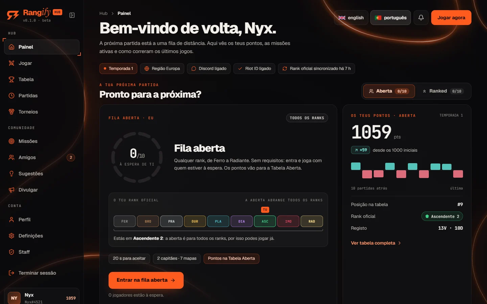
</p>

## O que é

O Rangify é um **hub competitivo de Valorant 5v5**. Dez jogadores da mesma região entram numa fila, aceitam a partida, dois capitães escolhem as equipas, banem os mapas à vez e jogam um grupo personalizado. No fim, a **Henrik Dev API** lê o jogo e diz o resultado e as estatísticas de cada um, por isso ninguém escreve resultados à mão.

Tudo conta para uma **tabela própria**: toda a gente começa a temporada com 1000 pontos, e o rank oficial da Riot nunca ordena nada.

> **Rangify é um projeto independente e não é desenvolvido nem apoiado pela Riot Games.**

<br>

## Contribuições

<div align="center">

<a href="https://github.com/simaocampanicodev/rangify/graphs/contributors">
  
</a>

O número de contribuidores e de commits do repositório está nos selos lá em cima e atualiza-se sozinho.

</div>

<br>

## Funcionalidades

- [Duas filas](#duas-filas-aberta-e-ranked)
- [A partida, fase a fase](#a-partida-fase-a-fase)
- [Pontos justos e tabelas](#pontos-justos-e-tabelas)
- [Perfil e estatísticas](#perfil-e-estatísticas)
- [Comunidade](#comunidade)
- [Discord](#discord)
- [Extensão do browser](#extensão-do-browser)
- [Streamers e convites](#streamers-e-convites)
- [Torneios](#torneios)
- [Área de staff](#área-de-staff)
- [Feito para jogar](#feito-para-jogar)

<br>

### Duas filas: aberta e ranked

<p align="center">
  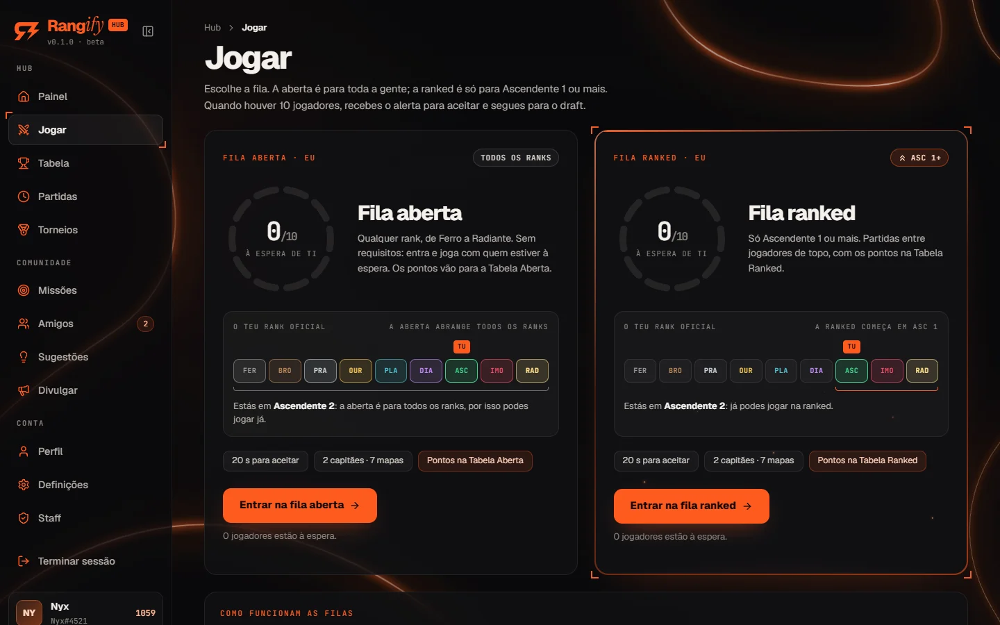
</p>

- **Fila aberta**: para toda a gente, de Ferro a Radiante, sem requisitos.
- **Fila ranked**: só para **Ascendente 1 ou mais**, com moldura própria, pontos próprios e a sua Tabela Ranked.
- Uma fila de cada vez, por região. A escada de ranks mostra onde estás e quantas divisões faltam para a ranked.
- Fechar o separador ou o browser tira-te da fila (um recarregar volta a pô-la), e quem fica sem dar sinal de vida é tirado ao fim de 3 minutos.
- Banir da fila, avisar e castigar quem não aceita, tudo pela staff.

<br>

### A partida, fase a fase

<table>
  <tr>
    <td width="50%">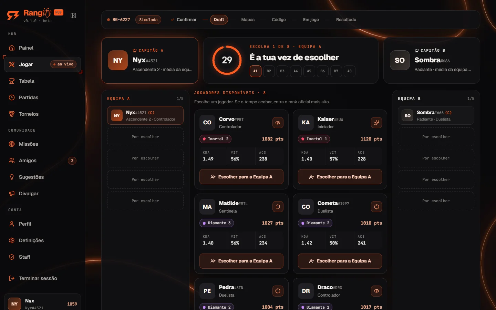</td>
    <td width="50%">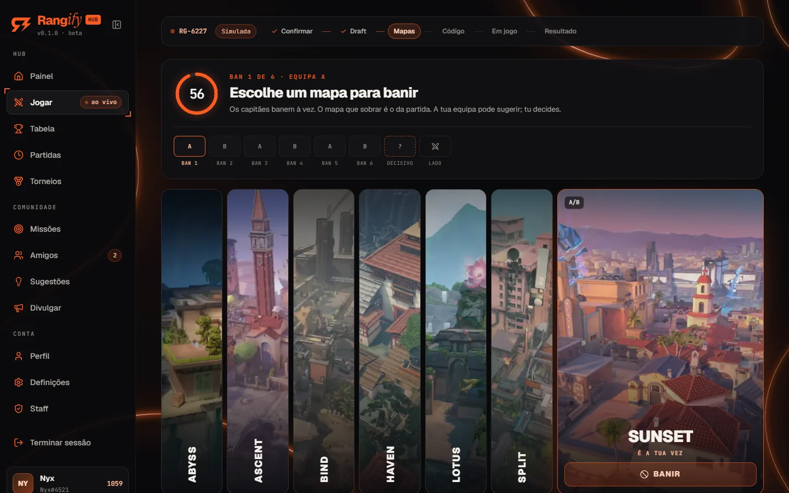</td>
  </tr>
  <tr>
    <td align="center"><b>Draft de capitães</b></td>
    <td align="center"><b>Ban de mapas</b></td>
  </tr>
</table>

1. **Confirmação**: 20 segundos para aceitar. Quem recusa fica 5 minutos de castigo e os outros voltam à fila com o mesmo lugar.
2. **Draft**: os dois capitães saem ao acaso. Escolhem à vez na ordem **A, B, B, A, A, B, B, A**, com 30 segundos por escolha. Se o tempo acabar, entra o rank oficial mais alto.
3. **Bans de mapas**: 13 mapas em cartões altos. Ao passar o rato, o cartão alarga e aparece o botão **Banir**. Os colegas de equipa sugerem e o capitão decide, 60 segundos por ban.
4. **Lado**: a equipa que não baniu por último escolhe atacar ou defender.
5. **Código do grupo**: um dos dois capitães partilha o código de 6 caracteres, e a página mostra as definições que o grupo tem de ter. Aqui, e nos primeiros minutos de jogo, **7 de 10 jogadores** podem votar para cancelar a partida (sem pontos nem castigos).
6. **Resultado**: os capitães só confirmam **quem ganhou** (A ou B). Quando os dois votam, ou 3 minutos depois do primeiro voto, a API da Riot define o resultado e quem ganhou: se alguém se enganar, ela corrige.

<p align="center">
  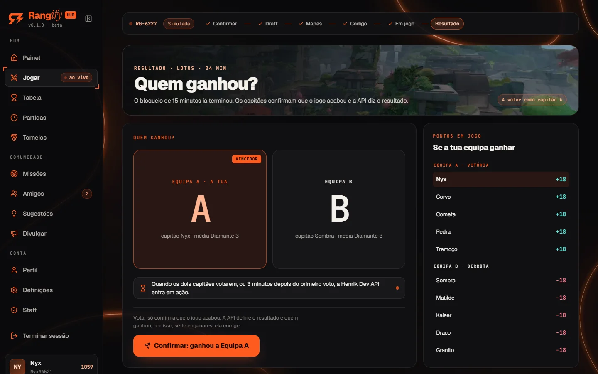
</p>

<br>

### Pontos justos e tabelas

<table>
  <tr>
    <td width="50%">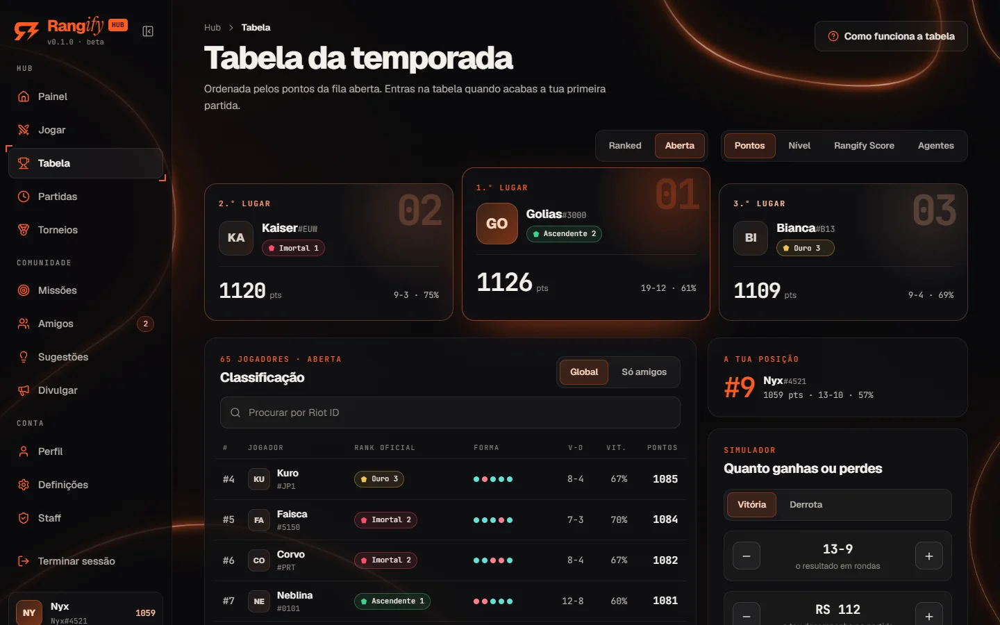</td>
    <td width="50%">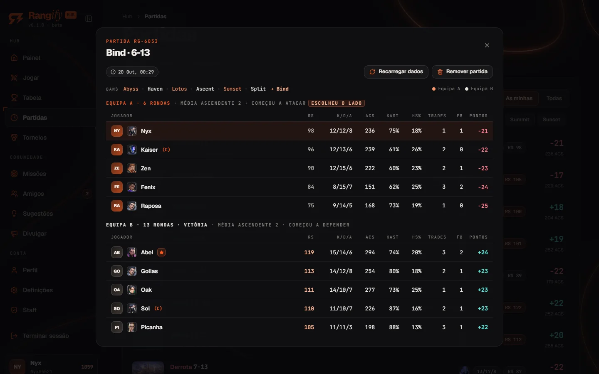</td>
  </tr>
  <tr>
    <td align="center"><b>Tabela da temporada</b></td>
    <td align="center"><b>Detalhe da partida</b></td>
  </tr>
</table>

- Cada partida vale **±20 pontos**, mais a **margem de rondas** (um 13-1 vale mais do que um 13-11) e o **desempenho** (Rangify Score, de -6 a +6).
- O **rank oficial da Riot não conta** para os pontos. É só informativo.
- **Quatro tabelas**: Pontos (aberta e ranked, cada uma com a sua), Nível, Rangify Score e Agentes (o melhor jogador de cada agente).
- O **Rangify Score** junta ACS, KDA, KAST e trades, comparados com a média da partida (100 é a média).

<br>

### Perfil e estatísticas

<table>
  <tr>
    <td width="50%">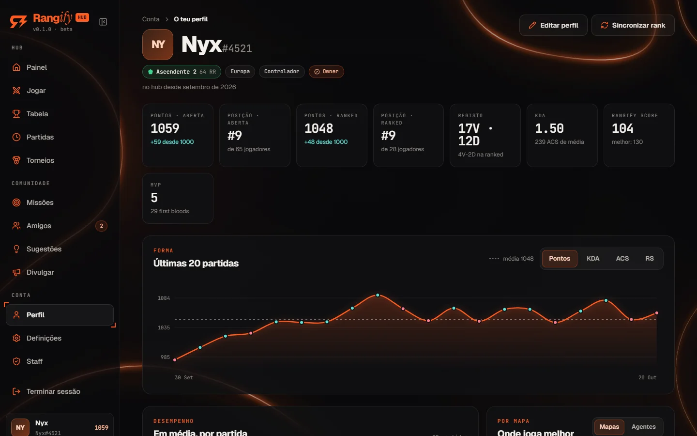</td>
    <td width="50%">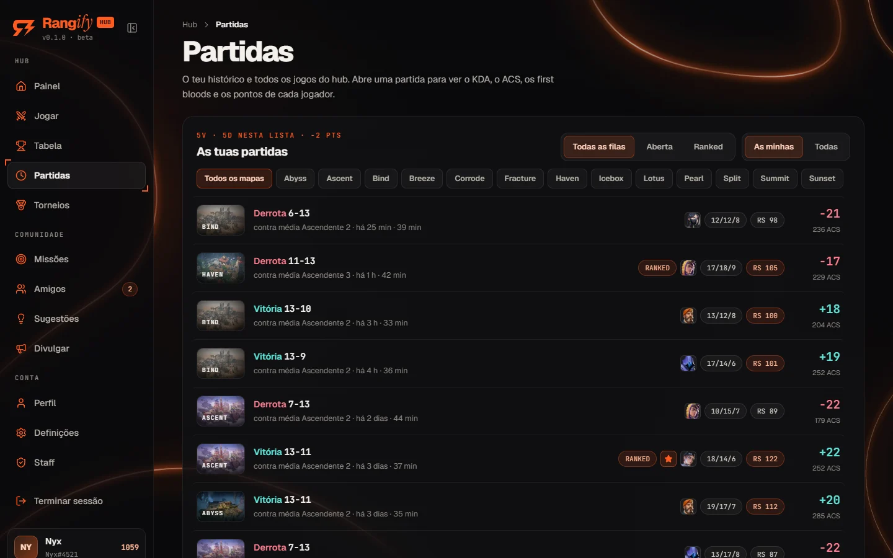</td>
  </tr>
  <tr>
    <td align="center"><b>Perfil</b></td>
    <td align="center"><b>Histórico de partidas</b></td>
  </tr>
</table>

- KDA, ACS, first bloods, trades, HS% e KAST de cada partida, a forma recente e os números por agente e por mapa.
- Histórico **das minhas** e **de todas**, filtrável por **fila** e por **mapa**, de 10 em 10 e com o scoreboard a carregar só quando abres a partida.
- O rank oficial atualiza-se sozinho depois de cada partida, sem ninguém ter de sincronizar.

<br>

### Comunidade

<table>
  <tr>
    <td width="50%">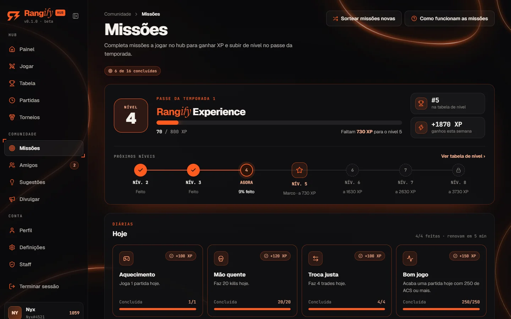</td>
    <td width="50%">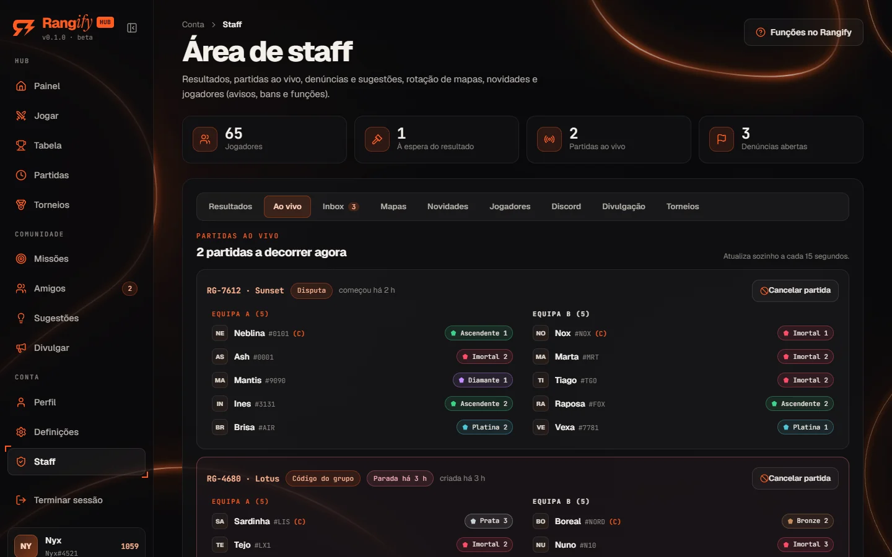</td>
  </tr>
  <tr>
    <td align="center"><b>Missões e níveis</b></td>
    <td align="center"><b>Partidas ao vivo (staff)</b></td>
  </tr>
</table>

- **Missões** diárias e semanais e o passe de **nível** (Rangify Experience), com XP.
- **Amigos**: pedidos em tempo real, quem está ativo e quem está em jogo.
- **Sugestões** da comunidade, com votos e estado, e **denúncias**.
- **Novidades** publicadas pela staff no Painel e um **tour** de boas-vindas para contas novas.

<br>

### Discord

<p align="center">
  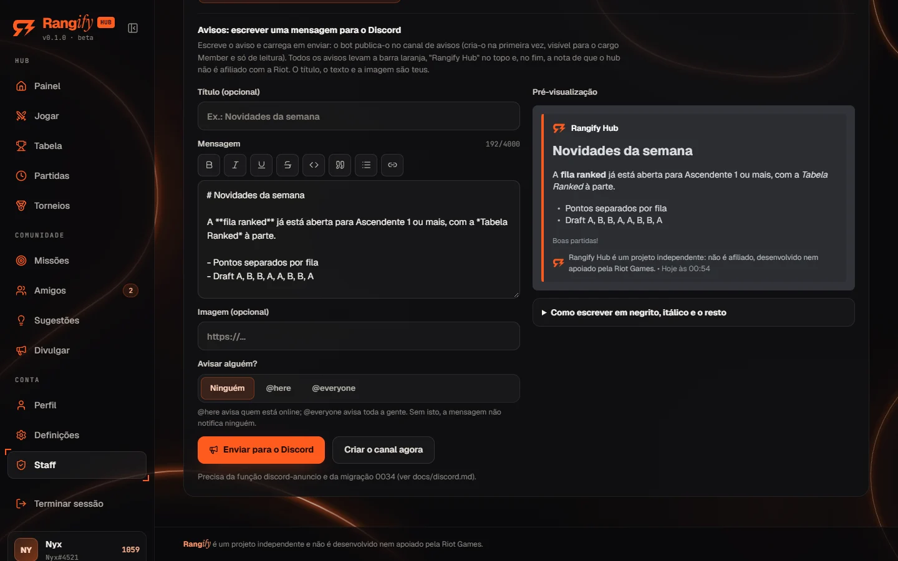
</p>

- **Entrar com o Discord**, com a opção de exigir o servidor para entrar na fila.
- **Canais por partida**: um chat só para os 10 jogadores e uma call por equipa, criados e apagados pelo bot. O botão **Call da equipa** leva-te lá.
- **Canais das filas** com a contagem em direto, o botão **Entrar na fila** e o cargo **Ranked** (dado e tirado pelo rank oficial).
- **Chamar para a fila** com um botão no canal de ping, com limite de uma chamada de 5 em 5 minutos.
- **Avisos**: a staff escreve no site, com pré-visualização e guia de formatação, e o bot publica-os num canal só de leitura, sempre com a barra laranja do Rangify.
- Mensagens privadas do bot quando a staff dá um aviso ou um ban.

<br>

### Extensão do browser

Uma extensão para **Chrome, Edge e Brave** com a roda da fila no popup, o botão de entrar e sair e o **aviso de partida encontrada a tocar na extensão**, por isso ouves a partida mesmo com o YouTube à frente.

<br>

### Streamers e convites

- **Overlay do OBS** com o rank, os pontos e a última partida, e uma **marca animada** para a live.
- **Twitch ligada ao perfil**, com o selo **AO VIVO** ao lado dos jogadores que estão em direto.
- **Convites** com código e link próprios, com recompensa para quem convida e para quem é convidado.

<br>

### Torneios

Equipas de 5 + coach + 2 suplentes, **fase de grupos** e **playoffs** de eliminação simples, **picks e bans de mapas** com os capitães das duas equipas, sorteio e calendário pela staff e **resultados lidos da API da Riot**.

<br>

### Área de staff

- **Resultados** e **partidas ao vivo**: quem joga em cada uma, há quanto tempo e se alguma está parada.
- **Inbox** (denúncias e sugestões), **mapas** (a rotação), **novidades** e **jogadores** (avisos, bans da fila, funções e pontos).
- **Discord** (os avisos e as mensagens do bot), **Divulgação** e **Torneios**. A Divulgação e os Torneios nascem fechados e abrem-se a toda a gente quando a staff quiser.
- **Ferramentas de teste** para Owner e Dev: simular a fila cheia ou uma partida completa com bots, sem mexer nos pontos reais.

<br>

### Feito para jogar

<table>
  <tr>
    <td width="33%"></td>
    <td width="33%">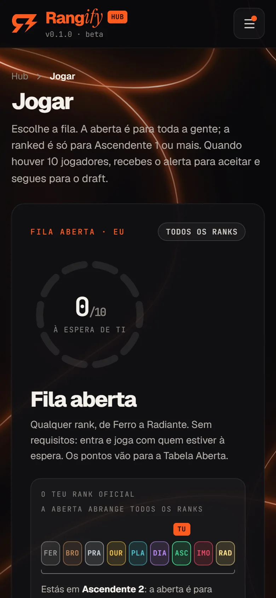</td>
    <td width="33%">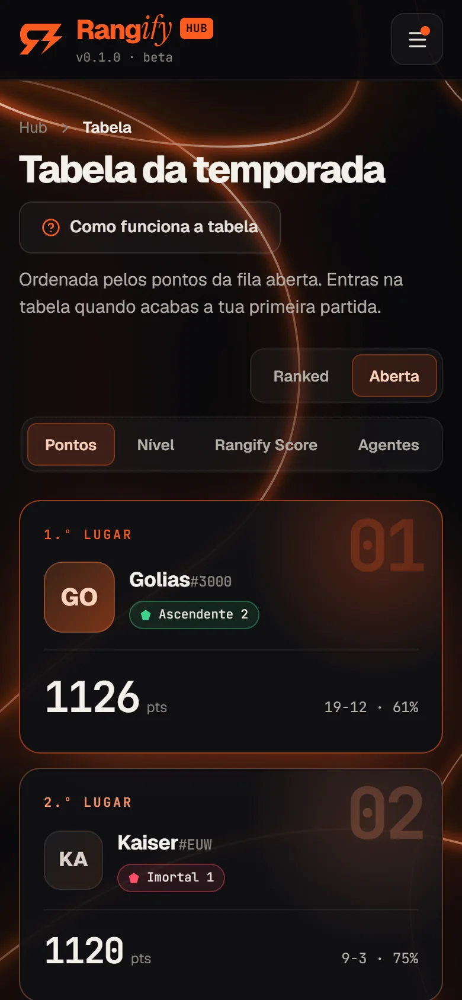</td>
  </tr>
</table>

- **Português e inglês**, com a escolha no topo.
- **Telemóvel e computador**, com o mesmo fluxo de jogo.
- **Fundo animado ou leve**: o modo leve deixa o fundo estático (e liga-se sozinho com o portátil a bateria).
- Pensado para **não pesar**: dados em páginas pequenas, pedidos que pausam com o separador escondido e imagens leves.
- **Modo demo** completo no browser, com 64 jogadores de exemplo, para experimentar sem configurar nada.

<br>

## Começar

```bash
git clone https://github.com/simaocampanicodev/rangify.git
cd rangify
npm install
npm run dev
```

Abre em http://localhost:5175. Sem configuração nenhuma, o site arranca em **modo demo**: tudo fica no browser e os outros 9 jogadores de cada partida são bots que aceitam, escolhem, banem e confirmam.

- **Entrar como Nyx#4521** abre a conta de exemplo (Owner, com histórico).
- Em **Jogar**, os botões **Simular fila cheia** e **Simular partida completa** deixam-te ver todas as fases.

Para ligar a um projeto Supabase real (contas, Discord, a API da Riot e a máquina de estados na base de dados), segue o guia em [docs/setup.md](docs/setup.md). O deploy no Render está em [docs/deploy.md](docs/deploy.md).

<br>

## Como está organizado

```text
rangify/
├── src/                 O site (React + TypeScript)
│   ├── pages/           Uma pasta por página: Painel, Jogar, Tabela, Perfil, Staff...
│   ├── components/      Componentes (match/ tem as fases da partida, tournaments/ os torneios)
│   ├── lib/             Regras, pontos, ranks, mapas e data/ (a camada de dados: demo e Supabase)
│   ├── contexts/        Sessão, partida em curso e avisos
│   └── hooks/           Carregar dados, polling inteligente, relógios
├── supabase/
│   ├── migrations/      O esquema, a máquina de estados e todas as regras em SQL
│   └── functions/       As Edge Functions (Henrik API, bot do Discord, Twitch, avisos...)
├── extension/           A extensão do browser (Chrome, Edge e Brave)
├── scripts/             Testes (SQL, filas, torneios...) e ferramentas
├── assets/              Marca, banners do Discord, mapas originais e imagens deste README
├── public/              Ficheiros estáticos do site (favicon e arte dos mapas)
└── docs/                Toda a documentação
```

A lógica do jogo vive na **base de dados**: os clientes só leem, e tudo o que muda dados passa por funções SQL `security definer` que fazem de máquina de estados. O site tem duas implementações da mesma interface, uma para o Supabase e outra para o modo demo, por isso o que vês na demo é o que corre a sério. A arquitetura completa está em [docs/architecture.md](docs/architecture.md).

<br>

## Documentação

Tudo está em [`docs/`](docs/README.md):

| Guia | O que tem |
| --- | --- |
| [Instalar e configurar](docs/setup.md) | Correr em local, variáveis de ambiente e ligar o Supabase |
| [Arquitetura](docs/architecture.md) | A máquina de estados, os pontos, as Edge Functions e os testes |
| [Deploy](docs/deploy.md) | Render, Supabase, Discord, Henrik Dev API e GitHub, passo a passo |
| [Discord](docs/discord.md) | O bot, os canais, o botão de chamar, os avisos e o cargo Ranked |
| [Torneios](docs/tournaments.md) | Equipas, grupos, playoffs e picks e bans |
| [Streamers](docs/streamers.md) | Overlay do OBS, Twitch e convites |
| [Extensão do browser](docs/extension.md) | Instalar a extensão e publicá-la nas lojas |
| [Desempenho](docs/performance.md) | O que se mediu, o que mudou e o que ficou de fora |

<br>

## Testes

```bash
npm run build         # tipos e build do site
npm run testar-sql    # as migrações e as regras, num Postgres local (PGlite)
```

Os testes jogam partidas inteiras pelas funções SQL: a fila, a confirmação, o draft, os bans, o código, o resultado, os pontos, as filas aberta e ranked, os torneios, a segurança (RLS e funções internas) e o modo demo.

<br>

## Contribuir

Encontraste um problema ou tens uma ideia? Abre um [issue](https://github.com/simaocampanicodev/rangify/issues). Para mudar código:

1. Faz um fork e cria um ramo a partir de `main`.
2. Corre `npm run build` e `npm run testar-sql` antes de abrir o pull request.
3. As mudanças na base de dados são **migrações novas** em `supabase/migrations/` (nunca mudes as antigas) com o teste respetivo em `scripts/`.

<br>

<div align="center">


<sub><b>Rangify é um projeto independente e não é desenvolvido nem apoiado pela Riot Games.</b></sub>

</div>
